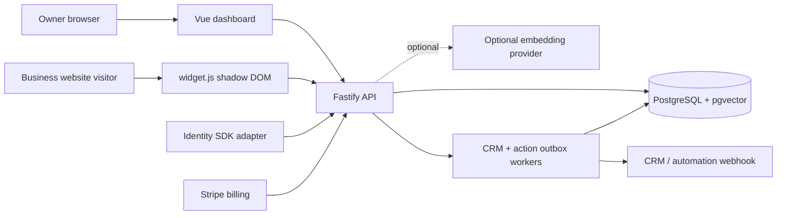
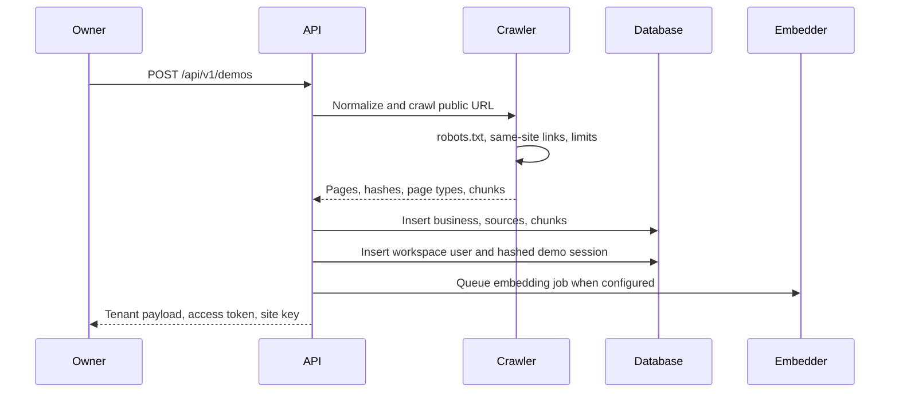
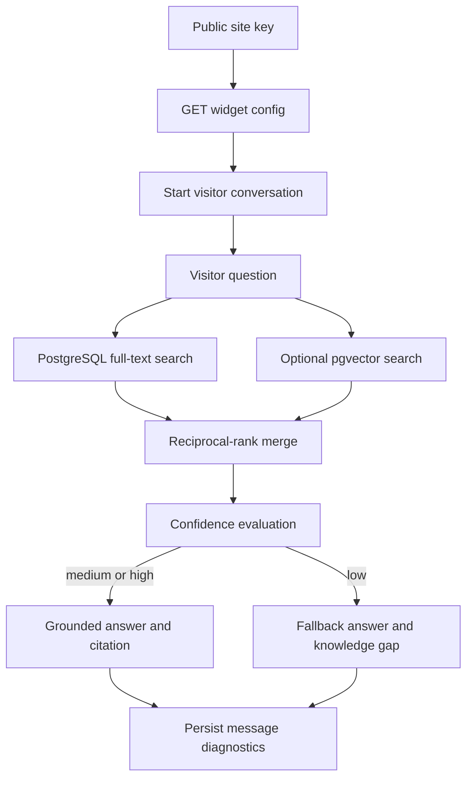
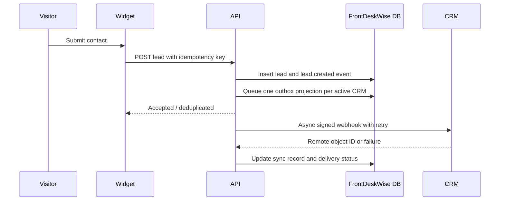

# FrontDeskWise Architecture

This document describes the architecture implemented in the current FrontDeskWise MVP slice and separates active behavior from planned integrations.

## Architecture status

The current system is a tenant-scoped Fastify API backed by PostgreSQL and pgvector, with a Vue owner dashboard and a standalone public widget. It supports URL-to-demo onboarding, bounded crawling, full-text retrieval, optional vector retrieval, confidence-aware answers, structured business facts with provenance and freshness, lead capture, knowledge-gap approval, configurable action flows, versioned workflow steps, business-scoped team access, durable human handoff, staff notifications, assignments, internal notes, demo billing state, widget installation, and durable CRM lead delivery.

The remaining intentionally limited areas are:

- Additional CRM OAuth adapters and provider-specific field mapping beyond the current HubSpot and signed-webhook adapters.
- Scheduled recrawls, change detection, and production CDN verification.
- SMS/Slack notification channels and multi-channel realtime transport; the current handoff path uses in-app notifications, optional SES email, and visitor polling.
- Provider-specific fact sync jobs and inbound webhooks beyond the current action/provider seams; those should write normalized facts only after the provider confirms the result.

Firebase authentication, Stripe checkout/webhooks/customer portal, S3 private document storage with PDF/DOCX/spreadsheet extraction, SES transactional mail, website ownership verification, and the super-admin demo operations are implemented behind their required environment configuration.

## High-level architecture



## Runtime components

| Component | Location | Responsibility |
| --- | --- | --- |
| Landing page and owner dashboard | `apps/web/src/App.vue` | URL onboarding, demo dashboard, conversation testing, knowledge review, agent configuration |
| Public widget | `apps/web/public/widget.js` | Site-key configuration, visitor conversation, citations, fallback lead capture |
| HTTP API | `apps/api/src/server.ts` | Tenant resolution, demo provisioning, auth boundary, conversations, retrieval, leads, CRM endpoints, widget routes |
| CRM adapter | `apps/api/src/crm.ts` | AES-GCM credential envelope, signed webhook delivery, timeout and response handling |
| Website crawler | `apps/api/src/crawler.ts` | URL normalization, robots handling, bounded same-site crawl, extraction, chunking |
| Embedding client | `apps/api/src/embeddings.ts` | Optional provider calls and vector formatting |
| Database adapter | `apps/api/src/database.ts` | Database-name guard, SSL normalization, PostgreSQL pool creation |
| Migration runner | `apps/api/src/migrate.ts` | Ordered, checksum-verified, advisory-locked migrations |
| Database schema | `infra/db/001_initial.sql` through the latest numbered migration | Tenant data, knowledge, structured business facts, billing, access sessions, retrieval, widget, lead events, CRM job state, organization billing, audited demo operations, ownership verification, private document processing, model usage diagnostics, team access, handoff state, notifications, assignments, and internal notes |

## Normalized business model and write boundary

FrontDeskWise treats website pages, documents, owner-entered details, and connected providers as inputs to one tenant-scoped business model. They do not compete as undifferentiated chunks:

```text
Sources              → normalized entities/facts → resolver → AI front desk
Website / documents  → semantic chunks           ↗
Owner details        → business_facts            ↗
Live providers       → business_facts/actions    ↗
```

`business_facts` stores the canonical structured read model for hours, pricing, locations, contacts, services, policies, schedules, and availability. Each fact carries `source_type`, `source_id`, explicit `authority`, `observed_at`, `freshness_policy`, `confidence`, and an optional expiry. Resolution ranks fresh system-of-record data above owner-verified structured data, documents, website evidence, and inferred information, and records conflicts instead of choosing by vector similarity. The deterministic resolver currently handles structured answers for hours, pricing, locations, contacts, policies, and services before semantic retrieval runs.

The write path remains explicit. External systems are not mutated by retrieval or by free-form model output. A provider command must pass through an allowlisted action connector/outbox with idempotency and retry state; only a successful provider response should update the local normalized model. FrontDeskWise-owned facts use the business-facts CRUD boundary directly. This keeps the model bi-directional without giving the assistant arbitrary write access.

### Action registry review boundary

`business_actions` distinguishes owner intent (`origin = configured`) from website discoveries (`origin = discovered`). Discovered actions carry their source URL/type, extracted label, discovery timestamp, evidence, confidence, and classification reason, and enter `needs_review` disabled. The Super Admin registry can move them through `approved` and `active`; only approved/active enabled actions reach visitor action detection. Recrawls update discovered provenance, preserve configured actions, and disable removed discoveries with `source_removed` rather than deleting history.

Primary-action selection is explicit and stored on `businesses.primary_action_id`. A recrawl never replaces it. Enable/disable and primary changes invalidate the in-process tenant cache and write before/after values to `action_registry_audit`. Emergency actions additionally require verified business ownership, a website source with evidence, an explicit `call_emergency` type, and a telephone destination.

## Primary flow: URL to demo



Crawler limits are deliberately bounded for MVP:

- 20 pages maximum.
- Depth 2 maximum.
- Same normalized hostname and HTTP(S) protocol.
- 1 MB response limit.
- 8 second request timeout.
- Local/private/credential-bearing URLs rejected.
- `robots.txt` disallow rules honored when available.

Each extracted page stores its canonical URL, title, page type, content hash, crawl timestamp, and heading-aware chunks. Chunks target approximately 520 tokens with approximately 80 tokens of overlap.

## Primary flow: visitor question



Current retrieval behavior:

1. Normalize question terms and run tenant-scoped PostgreSQL full-text search.
2. If embeddings are configured and present, run vector similarity search.
3. Merge lexical and vector candidates with reciprocal-rank fusion.
4. Calculate a confidence score and band.
5. Return the best supported chunk with source and chunk identifiers.
6. Store confidence, citations, retrieval mode, candidate count, and top score.
7. Convert low-confidence questions into knowledge gaps.

An owner-approved answer is reused for the exact normalized question and marked as `approved_answer` retrieval. This is a controlled answer override, not an untracked prompt edit.

## Primary flow: lead capture, completion actions, and CRM delivery



FrontDeskWise is the source of truth for contact details, attribution, consent, and lead status. `crm_integrations` stores only encrypted credentials and non-secret configuration. `integration_outbox` is the durable delivery queue; `crm_sync_records` is the per-lead projection and audit state. A unique integration/idempotency key prevents duplicate deliveries across retries or multiple API instances. See [data-and-integrations.md](data-and-integrations.md) for the field inventory and adapter contract.

An action flow may also define a completion connector. The flow persists its lead first, creates an `action_outbox` job with an idempotency key, and returns the configured safe completion message. A separate worker executes the connector and records `ACTION_SUCCEEDED` or `ACTION_FAILED`; retry exhaustion is visible to operators without changing the lead. Connector implementations include generic signed webhooks, email, HubSpot, and vendor HTTP adapters for Jackrabbit, Square, Mindbody, and Calendly.

Action V2 adds a business-neutral step graph stored in `business_actions.steps`. Steps can capture conversational values, show compact forms, branch on conditions, look up or recommend structured results, confirm an outcome, invoke a connector, hand off to staff, or finish the action. `conversations.action_state` stores the current step, completed steps, lookup results, interruption stack, repeatable participant values, and any generated completion URL. A completion link uses an allowlisted HTTPS base URL and explicit source-to-provider field mappings; FrontDeskWise never infers or forwards legal/payment fields.

Action destinations are now modeled separately from knowledge in `business_action_resources`. A resource has a type (`registration`, `booking`, `job_application`, `payment`, or another business-neutral type), provider identity, structured matching fields, lifecycle status, validity dates, conditions, and a safe destination. `resolveAction` filters inactive, expired, full, and otherwise invalid resources before returning safe results. A workflow lookup can query this registry or a live provider; the Jackrabbit enrollment template resolves class IDs and live availability through the provider adapter instead of searching RAG chunks for a registration URL. Ambiguous matches remain a list so the presentation layer never guesses a destination.

The widget emits `conversion_events` for flow starts, field views/completions/abandonment, form display/submission, action outcomes, CTA clicks, handoff requests, lead capture, booking-link opens, and conversation abandonment. Funnel summaries are derived from those events per business and flow.

## Owner access boundary

Demo creation returns a short-lived bearer token. Only its SHA-256 hash is stored in `demo_access_sessions`.

```text
Bearer token
  → hash token
  → find active demo_access_session
  → verify expiry and revocation
  → verify workspace_users role
  → verify business_id matches route tenant
  → allow owner operation
```

Protected owner operations include:

- Leads and knowledge gaps.
- Knowledge-gap resolution.
- Retrieval diagnostics.
- Agent configuration.
- Widget installation.
- Embedding status and reindexing.
- CRM connection, test, retry, and sync inspection.

The readiness workflow is available through `POST /api/v1/demo/:slug/evaluation`.
It runs a bounded set of representative questions from indexed source content
plus an unsupported-question case, then reports pass rate, citation coverage,
safe fallback behavior, open gaps, and latency. Internal public demos can run
the same evaluation without an owner token. Public sample assistants can be
tested read-only through `POST /api/v1/demo/:slug/public/test`.

Visitor widget operations use the public site key and do not use owner tokens. The site key resolves to a tenant but does not expose database credentials or provider secrets. Dashboard test conversations and dashboard lead/booking actions use the separate slug routes and require the owner token.

The `workspace_users.identity_subject` column is reserved for the future Identity SDK integration. The current implementation does not create a second password-based identity system.

## Data model

```text
businesses
├── business_sources
│   └── knowledge_chunks
├── workspace_users
│   └── demo_access_sessions
├── conversations
│   ├── conversation_messages
│   ├── conversation_assignments
│   ├── conversation_events
│   └── internal_notes
├── leads
│   └── lead_events
├── notifications
├── crm_integrations
│   ├── integration_outbox
│   └── crm_sync_records
├── knowledge_gaps
├── agent_configs
├── embedding_jobs
├── billing_events
└── billing_plan_entitlements
```

Tenant ownership is represented by `business_id` on all business-facing records. The main invariants are:

- A source belongs to one business.
- A chunk belongs to one business and may reference one source.
- A conversation and all messages belong to one business.
- Leads and knowledge gaps are tenant-scoped.
- CRM connections, outbox rows, and sync records are tenant-scoped and never return credentials to the browser.
- Demo sessions bind a user and business together.
- Widget site keys resolve to exactly one business.

## Embedding job lifecycle

```text
queued
  ↓
running
  ├── success → succeeded
  └── error   → queued with exponential backoff
                    ↓
                retry up to max_attempts
                    ↓
                  failed
```

The current worker runs in the API process but uses durable `embedding_jobs` rows. It supports startup recovery, attempt counters, next-attempt timestamps, progress counts, and provider/model metadata. Startup probes the OpenAI embedding path without logging secrets. Business readiness distinguishes `SEMANTIC_SEARCH_HEALTHY`, `DEGRADED_FULL_TEXT_ONLY`, `EMBEDDING_CONFIGURATION_ERROR`, and `EMBEDDING_BACKLOG`; full-text fallback is explicit rather than presented as semantic readiness.

## Cost-aware answer routing

After retrieval, the API applies a three-tier policy before answering a visitor question:

- `tier0`: greetings and approved knowledge-gap answers are deterministic and do not call a model.
- `tier1`: ordinary grounded questions use the `fast` capability (`FRONTDESKWISE_MODEL_FAST`, default `gpt-4o-mini`).
- `tier2`: ambiguous, multi-part, or weakly evidenced questions use the `balanced` capability (`FRONTDESKWISE_MODEL_BALANCED`, default `gpt-4o`).

The capability names are the application contract; model IDs and per-million-token
rates are deployment configuration. The legacy `FRONTDESKWISE_LLM_MODEL_TIER1`
and `FRONTDESKWISE_LLM_MODEL_TIER2` variables remain valid during migration. A
third `reasoning` capability (`FRONTDESKWISE_MODEL_REASONING`) is reserved for
low-frequency, high-impact work such as workflow generation/repair, Business
Brain synthesis, and offline certification. It is not placed on the visitor
hot path. Runtime workflow field extraction, next-best-action selection, and
provider/action execution remain deterministic.

Answers are constrained to retrieved business context. If model generation is unavailable or fails, FrontDeskWise falls back to the existing extractive answer or the configured knowledge-gap response. Route, model, token counts, latency, and optional estimated cost are persisted with the assistant message, while token totals roll up into organization usage. This makes the knowledge loop usable with only PostgreSQL full-text retrieval and progressively better when the OpenAI configuration is present.

Voice and live translation are intentionally separate future channels. When they
are introduced, realtime audio, transcription, and translation model IDs should
be configured independently and feed the same deterministic conversation and
workflow orchestrator; the current website widget does not invoke realtime
audio models.

### Workflow-semantics invariant

Model routing must never change workflow semantics. Models may extract or
interpret visitor language, but authorization, state transitions, provider
selection, and external actions remain platform-controlled. Changing the model
behind `fast`, `balanced`, or `reasoning` may improve language quality, but it
must not change whether a registration, booking, lead, or provider write is
allowed to execute.

## Widget installation

An authenticated owner receives a site-specific snippet from:

```text
GET /api/v1/demo/:slug/widget/install
```

Example shape:

```html
<script
  async
  src="https://app.example.com/widget.js"
  data-site="fdw_public_site_key"
  data-api="https://api.example.com"
></script>
```

The optional `data-pages` attribute accepts comma-separated URL paths and terminal-wildcard patterns. For example, `data-pages="/"` limits the widget to the home page and `data-pages="/,/services/*"` limits it to the home page plus service descendants. If omitted, the widget runs wherever the script is installed. Matching is based on `window.location.pathname`, ignores query/hash fragments, and normalizes trailing slashes. The loader checks the scope before creating its host or fetching configuration.

The widget loads its configuration by site key, renders inside a shadow root, starts a public visitor conversation, sends questions to the API, displays citations, and offers lead capture when an answer falls back. See [widget-installation.md](./widget-installation.md) for the complete installation contract.

The owner dashboard exposes the same assistant before installation, and the
public sample workspace uses the read-only test route so a prospect can ask a
real business question before creating an account.

## Billing and entitlements

The tenant billing state is stored independently from the payment provider:

```text
trial → active → grace → cancelled
             ↘ paused
```

Current demo defaults:

```text
billing_mode = sandbox
is_demo = true
billing_status = trial
plan_key = demo
```

The plan catalog and capability/limit records are provider-neutral. Stripe integration must only change billing state through verified, idempotent webhooks once enabled.

## Persistence and migration strategy

Migrations live in `infra/db/` and are applied by `apps/api/src/migrate.ts`.

The runner:

1. Requires the separate `frontdeskwise` database.
2. Acquires a PostgreSQL advisory lock.
3. Applies files in numeric order.
4. Stores a SHA-256 checksum per migration.
5. Refuses to continue if an applied migration changes.
6. Commits each migration independently.

The current chain is:

```text
001_initial.sql
002_content_hash_constraints.sql
003_demo_storage_hardening.sql
004_ingestion_billing_foundation.sql
005_billing_plan_entitlements.sql
006_retrieval_search_fields.sql
007_grounded_answer_contract.sql
008_embedding_jobs_widget.sql
009_crm_integrations_and_lead_events.sql
010_identity_organizations_and_business_membership.sql
011_cleanup_empty_backfill_organizations.sql
012_organization_billing_and_control_plane.sql
013_demo_operations_and_access_audit.sql
014_billing_entitlement_catalog.sql
015_organization_documents.sql
016_business_ownership_verification.sql
017_document_ingestion.sql
018_model_routing_observability.sql
019_action_flows.sql
020_human_handoff_inbox.sql
021_action_connectors_and_conversion_telemetry.sql
022_widget_shell_preferences.sql
023_proactive_privacy_preferences.sql
024_mcp_connections.sql
025–041 additional platform migrations
042_action_registry.sql
```

The database adapter rejects connection URLs aimed at another database name and normalizes the sibling service's `postgresql+asyncpg` format without copying credentials into FrontDeskWise.

## Current and future boundaries

### Active now

- URL-to-demo onboarding.
- Bounded website crawling and chunking.
- PostgreSQL persistence.
- Full-text retrieval.
- Optional vector retrieval and embedding jobs.
- Confidence-aware answer contracts.
- Knowledge-gap approval.
- Demo bearer authorization.
- Public site-key widget.
- Durable lead events and retryable CRM webhook delivery.
- HubSpot contact upsert adapter with optional capture-note activity.
- Stripe sandbox/live checkout, Customer Portal, signed webhook reconciliation, and plan entitlements.
- Guided MCP connections with encrypted tokens, discovered tool catalogs, and per-business allowlists.
- Structured action resources with lifecycle/status filtering, owner CRUD, and provider-backed enrollment lookup.

### Planned next

- Scheduled recrawls and content change detection.
- Per-tenant usage budgets and configurable cost alerts.
- Widget script verification and production CDN delivery.
- MCP tool-call runtime wiring, provider OAuth handshakes, additional native CRM adapters, richer field mapping, and provider rate-limit handling.

## Related documents

- [Data and CRM integrations](./data-and-integrations.md)
- [Staging launch checklist](./staging-launch-checklist.md)
- [End-to-end MVP and launch plan](./end-to-end-launch-plan.md)
- [Week-one launch plan](./week-one-launch-plan.md)
- [Product brief](./product-brief.md)
