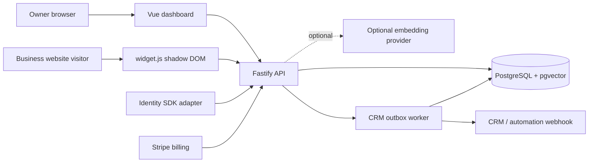
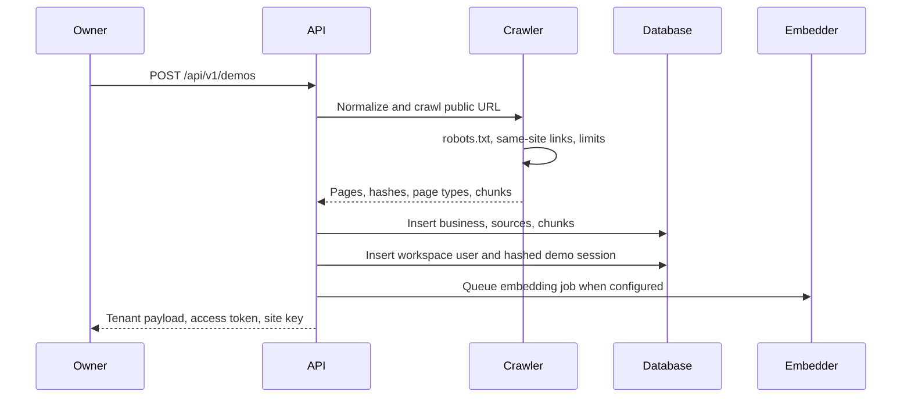
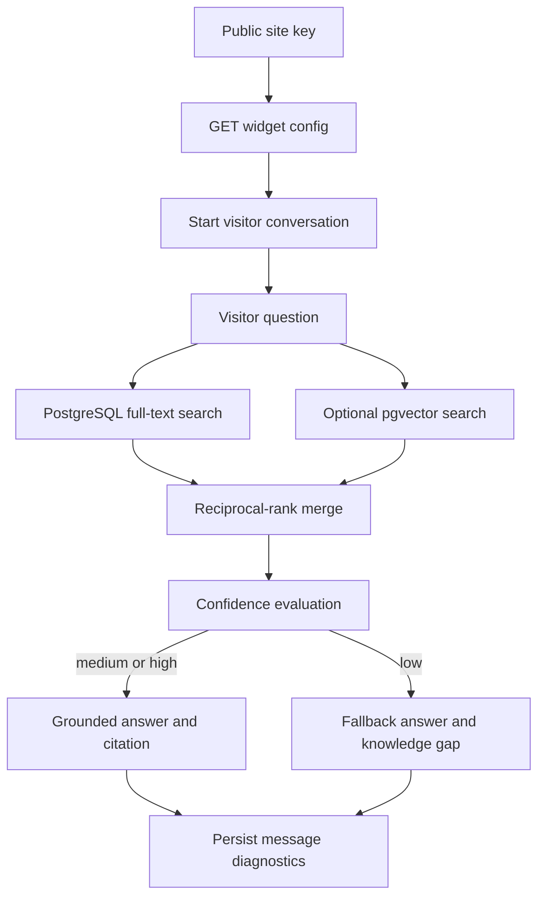
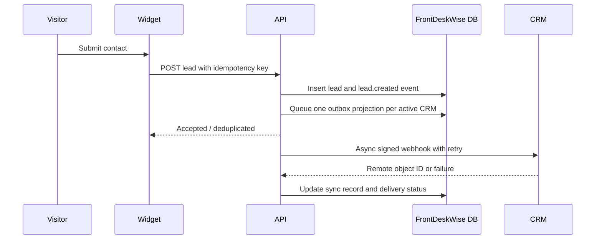

# FrontDeskWise Architecture

This document describes the architecture implemented in the current FrontDeskWise MVP slice and separates active behavior from planned integrations.

## Architecture status

The current system is a tenant-scoped Fastify API backed by PostgreSQL and pgvector, with a Vue owner dashboard and a standalone public widget. It supports URL-to-demo onboarding, bounded crawling, full-text retrieval, optional vector retrieval, confidence-aware answers, lead capture, knowledge-gap approval, demo billing state, widget installation, and durable CRM lead delivery.

The remaining intentionally limited areas are:

- Additional CRM OAuth adapters and provider-specific field mapping beyond the current HubSpot and signed-webhook adapters.
- Scheduled recrawls, change detection, and production CDN verification.

Firebase authentication, Stripe checkout/webhooks/customer portal, S3 private document storage with PDF/DOCX/spreadsheet extraction, SES transactional mail, website ownership verification, and the super-admin demo operations are implemented behind their required environment configuration.

## High-level architecture



## Runtime components

| Component | Location | Responsibility |
| --- | --- | --- |
| Landing page and owner dashboard | `apps/web/src/App.vue` | URL onboarding, demo dashboard, conversation testing, knowledge review, agent configuration |
| Public widget | `apps/web/public/widget.js` | Site-key configuration, visitor conversation, citations, fallback lead capture |
| HTTP API | `apps/api/src/server.ts` | Tenant resolution, demo provisioning, auth boundary, conversations, retrieval, leads, CRM endpoints, widget routes |
| CRM adapter | `apps/api/src/crm.ts` | AES-GCM credential envelope, signed webhook delivery, timeout and response handling |
| Website crawler | `apps/api/src/crawler.ts` | URL normalization, robots handling, bounded same-site crawl, extraction, chunking |
| Embedding client | `apps/api/src/embeddings.ts` | Optional provider calls and vector formatting |
| Database adapter | `apps/api/src/database.ts` | Database-name guard, SSL normalization, PostgreSQL pool creation |
| Migration runner | `apps/api/src/migrate.ts` | Ordered, checksum-verified, advisory-locked migrations |
| Database schema | `infra/db/001_initial.sql` through `017_document_ingestion.sql` | Tenant data, knowledge, billing, access sessions, retrieval, widget, lead events, CRM job state, organization billing, audited demo operations, ownership verification, and private document processing |

## Primary flow: URL to demo



Crawler limits are deliberately bounded for MVP:

- 20 pages maximum.
- Depth 2 maximum.
- Same normalized hostname and HTTP(S) protocol.
- 1 MB response limit.
- 8 second request timeout.
- Local/private/credential-bearing URLs rejected.
- `robots.txt` disallow rules honored when available.

Each extracted page stores its canonical URL, title, page type, content hash, crawl timestamp, and heading-aware chunks. Chunks target approximately 520 tokens with approximately 80 tokens of overlap.

## Primary flow: visitor question



Current retrieval behavior:

1. Normalize question terms and run tenant-scoped PostgreSQL full-text search.
2. If embeddings are configured and present, run vector similarity search.
3. Merge lexical and vector candidates with reciprocal-rank fusion.
4. Calculate a confidence score and band.
5. Return the best supported chunk with source and chunk identifiers.
6. Store confidence, citations, retrieval mode, candidate count, and top score.
7. Convert low-confidence questions into knowledge gaps.

An owner-approved answer is reused for the exact normalized question and marked as `approved_answer` retrieval. This is a controlled answer override, not an untracked prompt edit.

## Primary flow: lead capture and CRM delivery



FrontDeskWise is the source of truth for contact details, attribution, consent, and lead status. `crm_integrations` stores only encrypted credentials and non-secret configuration. `integration_outbox` is the durable delivery queue; `crm_sync_records` is the per-lead projection and audit state. A unique integration/idempotency key prevents duplicate deliveries across retries or multiple API instances. See [data-and-integrations.md](data-and-integrations.md) for the field inventory and adapter contract.

## Owner access boundary

Demo creation returns a short-lived bearer token. Only its SHA-256 hash is stored in `demo_access_sessions`.

```text
Bearer token
  → hash token
  → find active demo_access_session
  → verify expiry and revocation
  → verify workspace_users role
  → verify business_id matches route tenant
  → allow owner operation
```

Protected owner operations include:

- Leads and knowledge gaps.
- Knowledge-gap resolution.
- Retrieval diagnostics.
- Agent configuration.
- Widget installation.
- Embedding status and reindexing.
- CRM connection, test, retry, and sync inspection.

Visitor widget operations use the public site key and do not use owner tokens. The site key resolves to a tenant but does not expose database credentials or provider secrets. Dashboard test conversations and dashboard lead/booking actions use the separate slug routes and require the owner token.

The `workspace_users.identity_subject` column is reserved for the future Identity SDK integration. The current implementation does not create a second password-based identity system.

## Data model

```text
businesses
├── business_sources
│   └── knowledge_chunks
├── workspace_users
│   └── demo_access_sessions
├── conversations
│   └── conversation_messages
├── leads
│   └── lead_events
├── crm_integrations
│   ├── integration_outbox
│   └── crm_sync_records
├── knowledge_gaps
├── agent_configs
├── embedding_jobs
├── billing_events
└── billing_plan_entitlements
```

Tenant ownership is represented by `business_id` on all business-facing records. The main invariants are:

- A source belongs to one business.
- A chunk belongs to one business and may reference one source.
- A conversation and all messages belong to one business.
- Leads and knowledge gaps are tenant-scoped.
- CRM connections, outbox rows, and sync records are tenant-scoped and never return credentials to the browser.
- Demo sessions bind a user and business together.
- Widget site keys resolve to exactly one business.

## Embedding job lifecycle

```text
queued
  ↓
running
  ├── success → succeeded
  └── error   → queued with exponential backoff
                    ↓
                retry up to max_attempts
                    ↓
                  failed
```

The current worker runs in the API process but uses durable `embedding_jobs` rows. It supports startup recovery, attempt counters, next-attempt timestamps, progress counts, and provider/model metadata. If `OPENAI_API_KEY` is absent, the API reports `not_configured` and continues using full-text retrieval.

## Widget installation

An authenticated owner receives a site-specific snippet from:

```text
GET /api/v1/demo/:slug/widget/install
```

Example shape:

```html
<script
  async
  src="https://app.example.com/widget.js"
  data-site="fdw_public_site_key"
  data-api="https://api.example.com"
></script>
```

The widget loads its configuration by site key, renders inside a shadow root, starts a public visitor conversation, sends questions to the API, displays citations, and offers lead capture when an answer falls back.

## Billing and entitlements

The tenant billing state is stored independently from the payment provider:

```text
trial → active → grace → cancelled
             ↘ paused
```

Current demo defaults:

```text
billing_mode = sandbox
is_demo = true
billing_status = trial
plan_key = demo
```

The plan catalog and capability/limit records are provider-neutral. Stripe integration must only change billing state through verified, idempotent webhooks once enabled.

## Persistence and migration strategy

Migrations live in `infra/db/` and are applied by `apps/api/src/migrate.ts`.

The runner:

1. Requires the separate `frontdeskwise` database.
2. Acquires a PostgreSQL advisory lock.
3. Applies files in numeric order.
4. Stores a SHA-256 checksum per migration.
5. Refuses to continue if an applied migration changes.
6. Commits each migration independently.

The current chain is:

```text
001_initial
002_content_hash_constraints
003_business_location
003_demo_storage_hardening
004_ingestion_billing_foundation
005_billing_plan_entitlements
006_retrieval_search_fields
007_grounded_answer_contract
008_embedding_jobs_widget
009_crm_integrations_and_lead_events
```

The database adapter rejects connection URLs aimed at another database name and normalizes the sibling service's `postgresql+asyncpg` format without copying credentials into FrontDeskWise.

## Current and future boundaries

### Active now

- URL-to-demo onboarding.
- Bounded website crawling and chunking.
- PostgreSQL persistence.
- Full-text retrieval.
- Optional vector retrieval and embedding jobs.
- Confidence-aware answer contracts.
- Knowledge-gap approval.
- Demo bearer authorization.
- Public site-key widget.
- Durable lead events and retryable CRM webhook delivery.
- HubSpot contact upsert adapter with optional capture-note activity.
- Stripe sandbox/live checkout, Customer Portal, signed webhook reconciliation, and plan entitlements.

### Planned next

- LLM answer generation and cost-aware model routing.
- Scheduled recrawls and content change detection.
- Usage and cost metering.
- Widget script verification and production CDN delivery.
- Additional native CRM adapters, OAuth, richer field mapping, and provider rate-limit handling.

## Related documents

- [Data and CRM integrations](./data-and-integrations.md)
- [Staging launch checklist](./staging-launch-checklist.md)
- [End-to-end MVP and launch plan](./end-to-end-launch-plan.md)
- [Week-one launch plan](./week-one-launch-plan.md)
- [Product brief](./product-brief.md)
