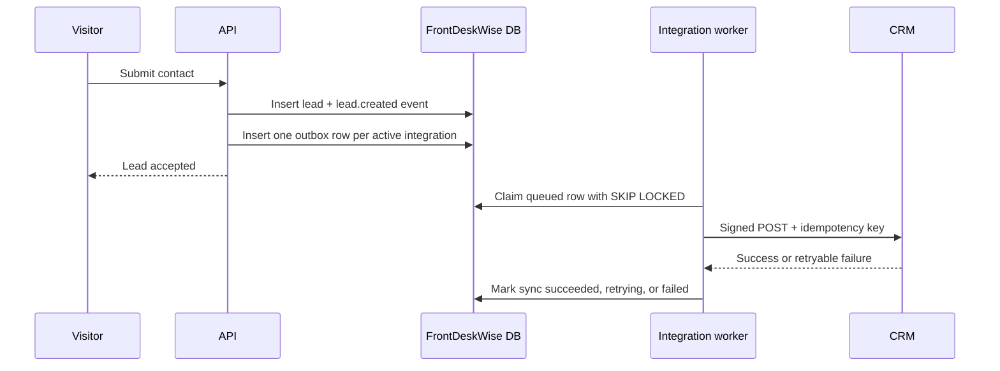

# FrontDeskWise data and CRM integrations

FrontDeskWise stores the operational record for each business. External CRMs are delivery projections: a lead is accepted by FrontDeskWise first, then delivered asynchronously with an idempotency key and a durable retry record.

## What is saved

Every record is tenant-scoped through `business_id`.

| Area | Tables | Purpose |
| --- | --- | --- |
| Tenant and access | `businesses`, `workspace_users`, `demo_access_sessions` | Business identity, owner role, and hashed demo/session access |
| Business model | `business_facts`, `business_actions`, `business_action_resources`, `action_registry_audit` | Structured facts and safe action destinations with source, authority, freshness, provider identity, action review lifecycle, and immutable operator changes |
| Website knowledge | `business_sources`, `knowledge_chunks`, `embedding_jobs` | Crawled pages, content hashes, chunks, optional vectors, and embedding job state |
| Conversations | `conversations`, `conversation_messages` | Visitor sessions, questions, answers, citations, confidence, retrieval mode, and actions |
| Lead capture | `leads`, `lead_events` | Contact details, intent, provenance, consent timestamp, bounded campaign metadata, and immutable lead events |
| Quality | `knowledge_gaps`, `agent_configs` | Unanswered questions, approved answers, and agent/widget configuration |
| Revenue state | `billing_events`, `billing_plan_entitlements` | Provider-neutral subscription and entitlement state |
| CRM delivery | `crm_integrations`, `integration_outbox`, `crm_sync_records` | Encrypted connection material, queued events, attempts, remote IDs, and delivery status |
| Action delivery and telemetry | `action_outbox`, `conversion_events` | Completion connector jobs, retries, funnel events, field drop-offs, and device/source context |
| MCP assistant connections | `mcp_connections` | Encrypted server credentials, discovered tools, read-only defaults, explicit allowlists, and connection health |

## Fact provenance and conflict resolution

`business_facts` is the normalized read model for facts that should not depend on the nearest semantic chunk. A fact records its subject and predicate (for example, `Turtle 2 / price`), JSON value, display value, source type, source identifier, explicit authority, observation time, freshness policy, confidence, and optional expiry.

The resolver applies this authority order:

```text
live_system → owner_structured → owner_knowledge → document → website → inferred
```

Stale or expired realtime facts are excluded from answers. When two usable sources disagree, the highest-authority fact wins for the visitor response and the alternatives remain available as an internal conflict for review. A provider sync should replace or version only the fields it owns; it should not rebuild unrelated website chunks or manual facts.

For writes, the local model is updated after the external provider confirms success. Deterministic commands use `business_actions`, `action_outbox`, and the explicit connector allowlist. MCP-discovered tools remain policy-gated and are not a shortcut around the command boundary.

## Action registry lifecycle

Website CTA extraction creates disabled, provenance-backed discoveries. Owner-created actions remain configured and are never overwritten by a recrawl.

```text
discovered → needs_review → approved → active → disabled
```

The registry records the source URL/type, extracted label, destination, discovery time, evidence, confidence, and classification reason. Review reasons include `low_confidence`, `unsafe_destination`, `duplicate_action`, `owner_override`, and `source_removed`. Primary-action changes and lifecycle changes record actor, previous value, new value, reason, and timestamp in `action_registry_audit`; the runtime cache is invalidated after each admin change. Emergency actions cannot be enabled from an inferred number: ownership, website source, evidence, explicit action type, and `tel:` destination must all be present.

## Lead record

The `leads` table is the source of truth for contacts captured through the dashboard or public widget. It stores:

- `conversation_id` when the contact came from a tracked conversation.
- `name`, `email`, `phone`, and `intent`.
- `status` (`new`, `qualified`, or `booked`).
- `source` (`widget`, `dashboard`, or a future channel adapter).
- `page_url` and `referrer` for attribution.
- `consent_at` when the visitor provides a consent timestamp.
- `metadata` containing only bounded campaign fields such as UTM values, click IDs, landing page, or form name.
- `idempotency_key` for safe retries from a widget, form, or integration.

Raw provider credentials are never stored in `leads`, logs, the browser, or source control. PII is retained because it is the product outcome the business asked FrontDeskWise to capture; production retention, export, and deletion controls should be added before general availability.

## Lead-to-CRM lifecycle



The important invariant is that a CRM outage cannot make a lead disappear. If delivery fails, the lead remains queryable in FrontDeskWise and the integration UI shows pending/failed counts. A unique `(integration_id, idempotency_key)` constraint prevents duplicate outbox jobs, while the lead's stable idempotency key prevents duplicate captures.

## Integration contract

The first adapters are a generic HTTPS webhook and a native HubSpot contact adapter. The webhook supports common automation tools, while HubSpot upserts contacts by email and can log a capture note. Both use the same durable outbox and sync-record boundary so additional native adapters can be added without changing lead capture.

Request headers include:

- `X-FrontDeskWise-Event: lead.created`.
- `X-FrontDeskWise-Idempotency-Key: lead.created:<lead-id>`.
- `X-FrontDeskWise-Signature: sha256=<HMAC>` when a signing secret is configured.

The JSON payload includes the tenant, conversation ID, lead fields, attribution metadata, and an event ID. Native HubSpot, Salesforce, Pipedrive, and GoHighLevel adapters should implement the same delivery result (`remoteObjectId`, `remoteUrl`) and use provider-native upsert/search semantics keyed by the FrontDeskWise lead ID.

## Failure handling

- New leads are inserted and queued in one database transaction.
- The worker claims rows with PostgreSQL row locks, so multiple API instances can process safely.
- Attempts use exponential backoff and stop after the outbox row's `max_attempts`.
- A terminal failure marks the integration as `error` and the lead sync as `failed`.
- Owners can test a connection and manually retry failed deliveries.
- Credentials are encrypted with AES-256-GCM using `FRONTDESKWISE_CREDENTIAL_KEY`; only the API decrypts them.

This foundation is intentionally narrower than a full CRM marketplace. OAuth, richer field mapping, webhook verification, contact update events, and provider-specific rate limits belong in additional native adapters after the lead loop is validated with real customers.

## Completion action connectors

Action flows can set `completion.connector` to `generic_webhook`, `email`, or `hubspot`, with vendor HTTP connector classes reserved for Jackrabbit, Square, Mindbody, and Calendly. `action_outbox` stores the serialized action input, provider, integration reference, attempts, retry time, remote identifiers, and last error. This queue is intentionally independent from `leads`: the lead is committed before the connector is queued, and connector failure cannot erase the customer record or change the customer-facing confirmation.

## Conversion telemetry

`conversion_events` is the tenant-scoped event stream for funnel reporting. Each event carries `organization_id`, `business_id`, optional `conversation_id`, optional `flow_id`, optional `field_id`, `event`, `occurred_at`, `source_page`, `device`, and bounded metadata. The public widget sends client-observed events through the site-key telemetry endpoint; server-side flow processing emits authoritative field, lead, form, completion, handoff, and connector events.

## MCP assistant connections

MCP is an additional agent-tool channel, not a replacement for deterministic completion connectors. Owners use the dedicated Connections screen to choose a provider, paste the provider-issued server URL and bearer token, test the connection, and review the discovered tools. Tokens are encrypted with the same `FRONTDESKWISE_CREDENTIAL_KEY` boundary and are never returned to the browser.

The API classifies discovered tools using MCP annotations and conservative name-based fallbacks. Read-only tools such as search, lookup, list, and get are enabled by default. Write and destructive tools remain disabled until an owner explicitly enables them. The current policy layer does not allow the model to execute every discovered tool automatically; completion actions continue through `ActionConnector` and `action_outbox` for deterministic idempotency and retry behavior.
