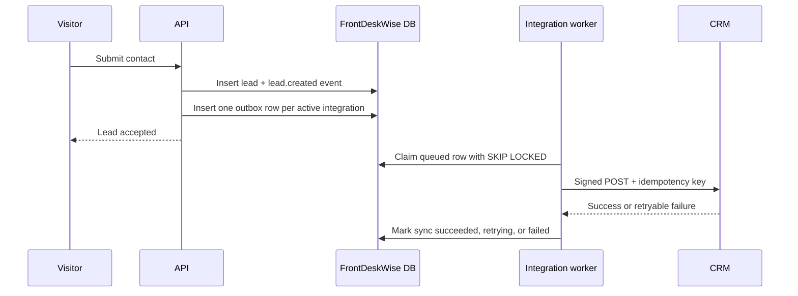

# FrontDeskWise data and CRM integrations

FrontDeskWise stores the operational record for each business. External CRMs are delivery projections: a lead is accepted by FrontDeskWise first, then delivered asynchronously with an idempotency key and a durable retry record.

## What is saved

Every record is tenant-scoped through `business_id`.

| Area | Tables | Purpose |
| --- | --- | --- |
| Tenant and access | `businesses`, `workspace_users`, `demo_access_sessions` | Business identity, owner role, and hashed demo/session access |
| Website knowledge | `business_sources`, `knowledge_chunks`, `embedding_jobs` | Crawled pages, content hashes, chunks, optional vectors, and embedding job state |
| Conversations | `conversations`, `conversation_messages` | Visitor sessions, questions, answers, citations, confidence, retrieval mode, and actions |
| Lead capture | `leads`, `lead_events` | Contact details, intent, provenance, consent timestamp, bounded campaign metadata, and immutable lead events |
| Quality | `knowledge_gaps`, `agent_configs` | Unanswered questions, approved answers, and agent/widget configuration |
| Revenue state | `billing_events`, `billing_plan_entitlements` | Provider-neutral subscription and entitlement state |
| CRM delivery | `crm_integrations`, `integration_outbox`, `crm_sync_records` | Encrypted connection material, queued events, attempts, remote IDs, and delivery status |

## Lead record

The `leads` table is the source of truth for contacts captured through the dashboard or public widget. It stores:

- `conversation_id` when the contact came from a tracked conversation.
- `name`, `email`, `phone`, and `intent`.
- `status` (`new`, `qualified`, or `booked`).
- `source` (`widget`, `dashboard`, or a future channel adapter).
- `page_url` and `referrer` for attribution.
- `consent_at` when the visitor provides a consent timestamp.
- `metadata` containing only bounded campaign fields such as UTM values, click IDs, landing page, or form name.
- `idempotency_key` for safe retries from a widget, form, or integration.

Raw provider credentials are never stored in `leads`, logs, the browser, or source control. PII is retained because it is the product outcome the business asked FrontDeskWise to capture; production retention, export, and deletion controls should be added before general availability.

## Lead-to-CRM lifecycle

The important invariant is that a CRM outage cannot make a lead disappear. If delivery fails, the lead remains queryable in FrontDeskWise and the integration UI shows pending/failed counts. A unique `(integration_id, idempotency_key)` constraint prevents duplicate outbox jobs, while the lead's stable idempotency key prevents duplicate captures.

## Integration contract

The first adapters are a generic HTTPS webhook and a native HubSpot contact adapter. The webhook supports common automation tools, while HubSpot upserts contacts by email and can log a capture note. Both use the same durable outbox and sync-record boundary so additional native adapters can be added without changing lead capture.

Request headers include:

- `X-FrontDeskWise-Event: lead.created`.
- `X-FrontDeskWise-Idempotency-Key: lead.created:<lead-id>`.
- `X-FrontDeskWise-Signature: sha256=<HMAC>` when a signing secret is configured.

The JSON payload includes the tenant, conversation ID, lead fields, attribution metadata, and an event ID. Native HubSpot, Salesforce, Pipedrive, and GoHighLevel adapters should implement the same delivery result (`remoteObjectId`, `remoteUrl`) and use provider-native upsert/search semantics keyed by the FrontDeskWise lead ID.

## Failure handling

- New leads are inserted and queued in one database transaction.
- The worker claims rows with PostgreSQL row locks, so multiple API instances can process safely.
- Attempts use exponential backoff and stop after the outbox row's `max_attempts`.
- A terminal failure marks the integration as `error` and the lead sync as `failed`.
- Owners can test a connection and manually retry failed deliveries.
- Credentials are encrypted with AES-256-GCM using `FRONTDESKWISE_CREDENTIAL_KEY`; only the API decrypts them.

This foundation is intentionally narrower than a full CRM marketplace. OAuth, richer field mapping, webhook verification, contact update events, and provider-specific rate limits belong in additional native adapters after the lead loop is validated with real customers.
